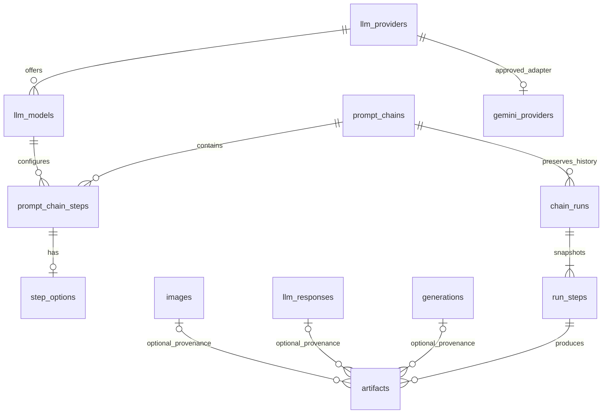

# Week 8 database architecture — proposal, not installed

This is an offline design based on repository evidence, not an assertion about a live Supabase schema. No database connection, SQL execution, seed operation, or Gemini request was made. The SQL lives under `supabase/proposals/week8`, outside an automatically applied migrations directory. No app handler invokes the proposed RPCs.

## Reviewed evidence

Read-only reference: `~/IdeaProjects/sage-nyc-admin`, HEAD `ebc0ef18226d5a80c3d3bfb0f201eafe97c21d91`. Relevant sources:

- `supabase/week7/01-domain-tables.sql`: catalog, chain/step, response and image definitions.
- `supabase/week7/02-prompt-chain-mix.sql`: global configuration lock, active-chain invariant and mix RPC.
- `supabase/01-admin-security.sql`, `docs/database-review.md`: profile promotion protection proposal and authorization limitations.
- `tests/fixtures/schema.sql`: synthetic representation of existing generations and account relationships.
- `lib/domain.ts`, `lib/domain-api.ts`, `lib/week7-validation.ts`: read-only chain/step UI, full-replacement mix, revisions, and catalog CRUD.
- `docs/week7-migrations.md`: deletion behavior, grants, account cascades, and unresolved live preconditions.

The Admin repository explicitly warns that SQL proposals and source inspection do not prove live grants, trigger bodies, or installed schema. In particular, profile promotion protection remains unverified. Week 8 requires its reviewed equivalent before installation; it does not install or assume that protection silently.

| Existing object      | Reviewed contract                                                                                                    | Week 8 treatment                                                                                     |
| -------------------- | -------------------------------------------------------------------------------------------------------------------- | ---------------------------------------------------------------------------------------------------- |
| `prompt_chains`      | UUID; unique `(slug,version)`; integer `revision`; weight 0–10,000; trimmed name/description                         | Reuse unchanged; create at weight zero; keep weight changes in the Week 7 RPC                        |
| `prompt_chain_steps` | UUID; chain/model RESTRICT FKs; positive position; immediate unique `(chain_id,position)`; instruction ≤20,000 chars | Reuse unchanged; add a parent-revision trigger, no constraint replacement                            |
| `llm_models`         | Provider FK RESTRICT; unique `(provider_id,model_key)`; enabled/revision                                             | Reuse catalog and snapshot model identifiers; no credential columns                                  |
| `llm_providers`      | Unique slug; enabled/revision                                                                                        | Explicit private allowlist maps reviewed provider IDs to the Gemini adapter; no guessed slug or seed |
| `llm_responses`      | Stored original text; nullable generation/importer links; immutable via Week 7 runtime except FK nulling             | Optional artifact provenance link; not used as a fabricated output store                             |
| `images`             | Private `admin-images` catalog with its own lifecycle and 5 MiB rules                                                | Optional provenance link only; no change to bucket or image CRUD                                     |
| `generations`        | Existing app request/owner records; account-deletion cascades                                                        | Optional nullable artifact link; no rows or constraints changed                                      |
| `profiles`           | Auth-user ID; Superadmin boolean; existing RLS/column privileges                                                     | Derive the actor from the signed session and recheck/lock the current boolean                        |

## Additive data model

All five new tables are in the private `prompt_tool` schema:

- **step_options**: one owned configuration row per live step, `input_source` and bounded generation parameters. Missing rows on old steps mean `previous_output` and `{}`. Deleting a live step deletes only its owned options. Changes through the RPC always touch the step so revisions reflect option changes.
- **gemini_providers**: operator-reviewed provider-ID allowlist. Empty by default; enqueue is blocked until a trusted operator provisions approved metadata. No runtime grant or mapping-management RPC is supplied.
- **chain_runs**: chain FK, nullable requesting profile, immutable chain-definition/revision snapshot, input, status/revision/timestamps, sanitized errors, and per-requester idempotency key. Chain deletion is RESTRICTed. Index `(chain_id,created_at DESC,id DESC)` supports stable history cursors.
- **run_steps**: ordered immutable step/model/provider/settings snapshots; resolved input, output, status, error, usage, timestamps, executor attribution, and a short execution lease. Composite run/chain FK prevents cross-chain association. `source_step_id` is a historical identifier, deliberately **not** a live FK; deleting a definition cannot mutate past snapshots. Snapshot positions are normalized 1..N even when live positions have gaps.
- **artifacts**: generated text or private media metadata tied by composite FK to a specific step/run/chain. Text outputs are also retained in `run_steps` for chaining; the artifact row is a stable output catalog. Optional generation/response/image links use SET NULL. Output content is immutable through runtime RPCs; only provenance links can be revised.

Account deletion clears requesting/executing profile attribution without deleting runs or generated content. No name/email fallback is copied into snapshots. Retained prompt/output content may still contain personal information; nullable attribution is not content erasure.

The existing user-facing app has no new queries or policies. Week 8 outputs do **not** automatically create or publish a `generation`, `plan`, `llm_response`, or `image`. Explicit provenance links do not assert identical content or publish private content.

## Authorization and HTTP boundary

New public `pct_*` RPCs are granted only to `authenticated`. They all invoke the private guard first; it requires a signed authenticated JWT, `auth.uid()`, server-managed Google provider claim, a Google identity row, and the current true Superadmin flag. It locks that profile `FOR SHARE` until transaction end. There is no actor-ID parameter to spoof. The profile flag must be protected from self-promotion in **all** existing write paths.

Private tables enable RLS without runtime policies. Neither `PUBLIC`, `anon`, `authenticated`, nor `service_role` has direct access. SECURITY DEFINER wrappers have empty search paths, qualified relations, an explicitly trusted owner, and limited bodies. Owner/DBA access is an administrative trust boundary. Existing Week 7 grants remain unchanged.

Future Next.js handlers must first use `requireSuperadmin()` for reads or `requireMutationSuperadmin(request)` for writes, then validate input and call RPC through the **user-session** client. Keep session cookies HttpOnly. The existing service-role client remains confined to its current flag lookup; it is not expanded into a business-data client. Do not pass a service-role token to new RPCs. SQL cannot verify browser origins: the server guard must still enforce the existing CSRF/same-origin requirements. Add a separately approved application write-enable gate before wiring mutations.

A direct Supabase API caller with a valid approved Google Superadmin JWT is intentionally authorized to these scoped RPCs. A normal user with an authenticated JWT is not. Authentication/session validation in Next.js and signed-JWT/identity/role checks in SQL are complementary; JWT expiry/revocation behavior still requires real Auth testing.

## CRUD, revisions, ordering, and Week 7 compatibility

- `pct_save_chain` creates or updates chain definitions, leaving weights untouched. The current `version` is a business label and may be edited while inactive; `revision` is the conflict token. Snapshots preserve both. Creating a new business version is a new chain row, not a retry of a run.
- `pct_save_step` appends new steps or updates a step belonging to the specified chain, including its options. It requires both chain and step revisions for updates. The chain ID cannot be changed on a step.
- The added step trigger bumps the parent chain through the existing Week 7 stamp function. Child edits invalidate previously opened mix forms and reorder forms. Revisions are monotonic tokens, **not** a promise of exactly one increment per request.
- All definition edits, reorders, and deletions require `mix_weight=0`. Use the existing Week 7 mix screen/RPC to deactivate before editing and reactivate afterward. Nothing silently changes the mix.
- Create at most 1,000 chains (the existing mix payload limit); edit/run at most 100 steps per chain. Existing larger chains are not rewritten: delete excess steps under review before execution/reordering.
- Configuration operations use the exact Week 7 transaction advisory lock `(77007,1)`, READ COMMITTED, and the order **profile → configuration lock → chain → steps**. Catalog writes from the old app already acquire the same configuration lock through its statement triggers.
- Reordering checks the expected parent revision and complete, unique, same-chain UUID set. It first shifts all rows into a disjoint positive band above the current maximum, then assigns 1..N. Both passes occur in one RPC transaction; immediate uniqueness stays enabled, and no negative sentinel positions or disabled triggers are used. Overflow/headroom checks fail closed. A failed phase rolls back everything. Unchanged contiguous order is a no-op.
- Each reorder can stamp each step twice and the parent up to 2N times. Refresh returned data before the next write. Reserved integer headroom prevents overflow; there is no revision reset/backfill.
- Step deletion retains all run snapshots. Position gaps are valid Week 7 state; explicit reorder compacts them. Chain deletion requires no steps and no history, and zero weight. FKs and dependency checks reject unsafe deletion or unreviewed cascading references/triggers. No archive flag is added because the Week 7 mix has no archive filter and requires every chain.

The Admin mix RPC retains its signature, full-chain-set requirement, integer weights, conflict checks and active-chain invariants. An added/deleted chain or a child edit makes an old mix form stale. The old app should receive a conflict and reload, never silently overwrite the new configuration.

## Execution persistence contract — no runner implemented

1. `pct_enqueue_run` checks the current chain revision, 1–100 steps, enabled models/providers and the reviewed Gemini provider mapping. It creates the run plus all step snapshots atomically. Reusing a requester/idempotency key with identical input/chain/revision returns the existing run; different content conflicts. Catalog identifiers/settings are captured from current database rows, not from request fields.
2. `pct_claim_step` checks the expected run revision, locks the run, and claims only its next pending step after all predecessors succeed. A run has at most one in-flight step. It rechecks current model/provider existence and enabled status as a kill switch, resolves input, and returns a random five-minute lease token, step revision and frozen request definition to the future server runner.
3. The future server calls Gemini **outside** any database transaction, using credentials from its environment only. It must validate actual model capabilities, enforce budget/rate/time limits, combine the snapshot instruction with resolved input, redact errors, and capture usage. None of that provider integration is implemented here.
4. `pct_finish_step` requires the same verified executor, step revision, unexpired lease and token. It records status, output, usage and artifacts in one transaction. A failure marks remaining pending steps skipped and fails the run. The last successful step completes the run. A duplicate or late completion conflicts; read the run before deciding whether a result already committed.
5. `pct_stop_run` supports cancellation or confirmed lease expiry. It invalidates in-flight leases and closes pending steps. A verified Superadmin can stop another run; only the lease's verified executor can finish that step. If an executor loses Superadmin access, completion is denied and another approved administrator can cancel/expire the run.
6. No in-run retry, automatic lease takeover, heartbeat or provider-call replay is included. Retry means a separately authorized new run/new key. Database idempotency does **not** make external Gemini calls exactly once: a crash after a provider call can leave an ambiguous billable outcome. Expired work fails instead of being automatically reissued.

Initial input mapping is deliberately linear: `chain_input` or `previous_output`, with the first step always using chain input. No arbitrary template interpolation, DAGs, tool execution, URL fetching, or expression evaluation is supported. A media-only output is permitted only if the next step does not require previous text. Actual multimodal provider requests remain a separate design/implementation step.

Status transitions:

| Record | Allowed flow through RPCs                                                                          |
| ------ | -------------------------------------------------------------------------------------------------- |
| Run    | queued → running → succeeded/failed; queued/running → cancelled; expired running → failed          |
| Step   | pending → running → succeeded/failed; pending → skipped after failure; pending/running → cancelled |
| Lease  | issued by claim → consumed by finish/stop; expired leases never authorize completion               |

## Text/media and external storage

Text is capped at 256 KiB per step output and artifact; inputs are capped at 20,000 characters at enqueue and 256 KiB after resolution. Proposed settings allow temperature 0–2, top-p 0–1 and max-output-tokens 1–65,536; these are schema ceilings, **not** claims that every Gemini model supports them or approved spend limits. Usage accepts only input/output/total token counts. Sanitized error text is capped at 2,000 bytes, not raw provider bodies.

Media references use a proposed **separate private** `prompt-chain-artifacts` bucket and canonical `<run UUID>/<object UUID>.<extension>` paths. No signed URL or credential is stored. The proposed metadata ceiling is 50 MiB and at most 16 media artifacts per step; this is separate from the Admin image catalog's 5 MiB limit. MIME/kind/path/size checks validate metadata, not actual bytes. Storage bucket creation, upload decoding/scanning, signed URL handlers and cleanup are not supplied or executed.

Upload and database commit cannot be atomic. A future runner must use fresh object IDs, upload/validate first, commit references only on accepted completion, and queue reconciliation for orphaned uploads if completion fails. Do not delete an object referenced by committed artifacts. Media execution must remain disabled until this lifecycle and private-bucket policy are implemented and verified. Text-only run persistence does not depend on a Storage bucket.

## Read and error contracts

`pct_list_chains`, `pct_read_chain`, and `pct_model_catalog` expose authorized definition/catalog reads. `pct_run_history` uses `(created_at,id)` keyset pagination scoped by chain, limit 1–100. `pct_read_run` returns the run, ordered steps and artifacts in one SQL snapshot, excluding lease tokens. `pct_link_artifact` updates optional provenance links with an expected artifact revision, checks artifact kind, and rejects inconsistent response/generation pairs.

Future handlers should map database errors without returning raw SQL/provider text:

| SQLSTATE                           | Intended response                                                            |
| ---------------------------------- | ---------------------------------------------------------------------------- |
| `42501`                            | 403 after app identity check; 401 remains the app's unauthenticated response |
| `40001`, `40P01`, `55P03`          | 409 conflict/reload; never silently replay a model call                      |
| `23503`, `23505`, `23514`, `23001` | 409 dependency, duplicate or current-state conflict                          |
| `22023`, `22P02`, `22003`, `23502` | 400 invalid input                                                            |
| `P0002`                            | 404 for a missing authorized resource                                        |
| other errors                       | sanitized 503; log only nonsecret correlation information                    |

TypeScript files in `src/lib/database` describe proposal contracts, not a generated representation of an installed database. `planStepReorder` is a pure offline/input-validation helper, never a sequence of independent database requests. The SQL RPC is authoritative.

Sources informing the design: [PostgreSQL explicit locking](https://www.postgresql.org/docs/current/explicit-locking.html), [constraints](https://www.postgresql.org/docs/current/ddl-constraints.html), [Supabase database functions](https://supabase.com/docs/guides/database/functions), and [Supabase RLS](https://supabase.com/docs/guides/database/postgres/row-level-security).
